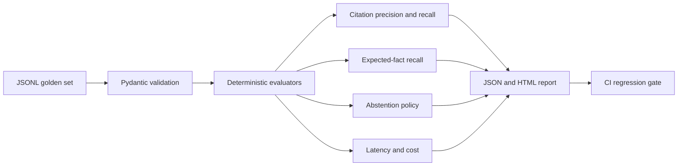

# LLM Reliability Lab

**[Run the suite live →](https://llm-reliability-lab-demo.vercel.app)** — scores the bundled dataset in
the browser and shows which case fails and why. The [HTML report](https://llm-reliability-lab-demo.vercel.app/report/sample) is the same one CI writes.

Deterministic offline evaluation for grounded LLM applications. Measures citation validity, citation recall, expected-fact coverage, abstention behavior, latency SLOs, and estimated model cost before a prompt or retrieval change reaches production.

No LLM judge. No API key. Same dataset produces same result in local runs and CI.

## Why

LLM demos optimize for a good answer. Production systems need failure visibility:

- Did the answer cite a document that retrieval never returned?
- Did it omit the source required by the golden set?
- Did it answer when evidence was missing?
- Did latency cross the product SLO?
- Did a model change increase cost?

This repository turns those checks into regression tests.

## Architecture



## Quick start

```bash
python -m venv .venv
.venv/Scripts/activate  # Windows
python -m pip install -e ".[dev]"
python -m pytest

llm-reliability-eval sample_data/eval_cases.jsonl \
  --json reports/report.json \
  --html reports/report.html
```

The sample intentionally contains one hallucinated citation and one latency breach. CLI returns a non-zero exit code when any case fails, making the dataset a CI gate.

## API

```bash
uvicorn llm_reliability_lab.api:app --reload
```

- `GET /health`
- `POST /evaluate` returns a typed JSON report.
- `POST /evaluate/html` returns a standalone failure dashboard.
- OpenAPI: `http://localhost:8000/docs`

## Dataset contract

One JSON object per line:

```json
{
  "id": "refund-policy",
  "query": "What is the refund window?",
  "response": "Refunds are available for 30 days [policy-1].",
  "retrieved_ids": ["policy-1", "faq-2"],
  "expected_citations": ["policy-1"],
  "expected_facts": ["30 days"],
  "should_abstain": false,
  "latency_ms": 420,
  "input_tokens": 280,
  "output_tokens": 19
}
```

## Failure taxonomy

| Failure | Meaning |
| --- | --- |
| `invalid_citation` | Answer cited a source absent from retrieved context |
| `missing_citation` | Golden source was not cited |
| `missing_expected_fact` | Required fact absent from answer |
| `abstention_policy` | Model answered without evidence or refused unnecessarily |
| `latency_slo` | End-to-end latency exceeded configured SLO |

## Production extension points

- Export traces from Langfuse, OpenTelemetry, or an application database into JSONL.
- Replace exact expected-fact checks with a domain-specific deterministic matcher.
- Add retrieval metrics such as Hit@k, MRR, or nDCG before response evaluation.
- Store reports as CI artifacts and compare candidate vs baseline.
- Run the evaluator after prompt, model, chunking, or reranking changes.

## Verification

```bash
python -m ruff check .
python -m pytest
docker build -t llm-reliability-lab .
```

## License

MIT
